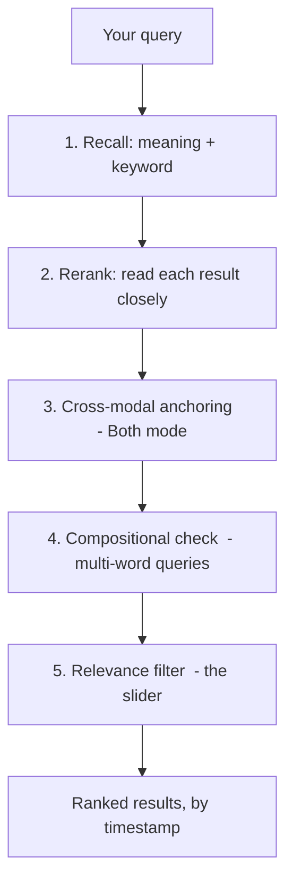

# How Search Works — Query Mechanics

This guide explains what actually happens when you type a query into Local Video
Search. It is written for curious end users who want to understand *why* a result
showed up (or didn't) and how to phrase queries to get the best results. No code
knowledge required.

---

## The 30-second version

When you analyze a video, the system writes down **two kinds of text** about it:

1. **What is shown** — a vision model looks at frames (sampled on a time grid
   *and* at scene cuts) and writes a plain-English caption of each one
   (e.g. *"a black mini PC with a wooden base sitting on a desk"*).
2. **What is spoken** — Whisper transcribes the audio into sentence-sized chunks
   (e.g. *"this little machine runs my whole home lab"*).

A third, optional layer called a **fused description** merges the two for the same
moment (what's shown + what's said) into one searchable sentence — this is what
lets *"a man talking to a hologram"* find a clip where the screen only ever says
"transparent display" and the narrator only ever says "hologram."

When you search, you're searching **that text**, not the raw pixels or audio. Every
result points to an exact **timestamp**, not just a filename.

---

## What each search source means

Under the search box there are two toggles — **Video** and **Audio** — that control
which kind of text your query is matched against:

| Toggle state | Search source | What it searches | Use it for |
|---|---|---|---|
| Video on, Audio off | **Visual** | Frame captions only | *"gold macbook"*, *"red sports car"*, *"BIOS screen"* — things you can **see** |
| Video off, Audio on | **Spoken** | Transcript only | *"talking about 4K gaming"*, a quote someone said — things you can **hear** |
| Both on (default) | **Cross-modal** | Captions **and** transcript **and** fused descriptions | Most searches, and anything where the answer is split across what's shown and what's said |

The default is **Both**, which casts the widest net and turns on the extra
cross-modal logic described below.

---

## The pipeline, stage by stage

Every search runs through the same stages. You don't see them individually — you
just get a ranked list — but here's what's happening behind the scenes, in order.

### 1. Recall — find candidates two different ways

The system casts a wide net using **two complementary methods at once**, then
merges them:

- **Meaning search (dense / semantic).** Your query and every caption are turned
  into vectors — mathematical fingerprints of *meaning*. This finds matches even
  when the words differ: *"android"* can match a caption that says *"humanoid
  robot"*, *"sofa"* matches *"couch"*. Great at synonyms; occasionally misses a
  match whose wording is unusual.
- **Keyword search (sparse / BM25).** A classic literal word-match index. If your
  exact words appear in a caption, this finds it even when the meaning-search
  ranked it far down the list. Great at rare, specific terms (a product name, a
  distinctive phrase); blind to synonyms.

The two result lists are blended with a technique called **Reciprocal Rank
Fusion** — anything that ranks highly in *either* method floats to the top of the
combined pool. This is why a video can show up because it's a close *meaning*
match **or** because it literally contains your words.

### 2. Rerank — read each candidate closely

Recall is fast but shallow. The top candidates are then handed to a **cross-encoder
reranker** — a model that reads your query and a caption *together* and scores how
well that specific caption answers that specific query. This is the stage that
respects fine details: it knows *"blonde woman"* ≠ *"blonde man"* even though four
of five words match. The reranker's score is what drives the ranking from here on.

> **Why bare single words score low.** The reranker expects a natural phrase. A bare
> noun like *"dog"* is ambiguous to it and scores in the uncertain middle. For
> short visual searches the system quietly also tries *"a video of {your words}"*
> and keeps whichever scores higher, so you don't have to pad your query yourself.

### 3. Cross-modal anchoring (Both mode only)

When both sources are on, the system lines up **what's shown and what's said in the
same moment**. If your query's distinctive words appear across the visual and
spoken tracks of one moment, that moment is recognized as a stronger match. It also
enforces honesty about the top tier: a moment can only be labeled an **Exact match**
if every distinctive word in your query literally appears in that moment — a
synonym match stays visible but is capped just below "Exact."

### 4. Compositional check (multi-word queries)

The reranker is good, but it scores on *evidence present*, not on whether your
query's attributes describe the **same object**. Consider *"mini pc with wooden
accent"*:

- ✅ **True match:** *"a black mini PC with a wooden base"* — the wood is part of the
  computer.
- ❌ **False match the reranker can be fooled by:** *"an AI Mini PC on a price tag…
  keyboards on wooden desks"* — there's a mini PC, and there's wood, but they're
  **different objects**. No keyword or word-distance rule can tell these apart (the
  false one may even say "Mac Mini" and "wooden table" in the same sentence).

For multi-word queries the system asks the local language model a focused question:
*"Does a single object in this scene satisfy the whole query?"* It then nudges each
candidate's score up (a confirmed match) or down (attributes that belong to
different objects). Synonyms still count; uncertain or unscored candidates are left
exactly as they were. This is a **gentle adjustment, not a gate** — it reorders the
shortlist, it never silently throws good results away.

### 5. Relevance filter — the slider

Finally, your **relevance slider** decides how strict the cut-off is. It maps to four
labeled stops:

| Slider stop | Meaning | When to use |
|---|---|---|
| **Nearly everything** | Loosely related and up | Exploring; you'll sift results yourself |
| **Mostly matches** *(default)* | Solid, on-topic results | Everyday searching |
| **Exact match** | Only high-confidence, literal matches | *"I'm sure this exact thing is in here"* |

The slider only changes the **threshold** applied at the very end — it does **not**
re-run the search. Slide left to see more (including weaker matches), slide right to
see only the system's most confident results. There's always a hard noise floor
underneath even "Nearly everything," so pure junk never appears.

---

## How to phrase queries

The system does a lot to meet you halfway, but a few habits get noticeably better
results.

- **Describe, don't command.** Conversational lead-ins actively *hurt* scores
  because the reranker treats them as part of the question. The system strips the
  common ones for you, but it's still best to search *"a kvm switch"* rather than
  *"hey can you find where I was talking about a kvm switch."*
- **Name attributes that matter.** Color, brand, material, on-screen text, count —
  *"gold macbook"*, *"SODOLA network switch"*, *"two travel routers"*. These are
  exactly what the captions record, so they rank well.
- **Keep it concise.** A few content words beats a long sentence. The search box
  rotates example phrasings to show the sweet spot.
- **Pick the right source.** If you're hunting a spoken quote, turn **Video** off so
  background frames don't dilute the match — and vice-versa for something purely
  visual.
- **Loosen the slider if you get too few results, tighten it if you get too many.**
  Recall is the same at every setting; only the cut-off moves.

---

## Metadata filters (optional)

The **Filters** button narrows *any* search by hard criteria — media type, minimum
resolution, or creation date — applied **after** the relevance ranking. These are
exact filters, not natural language: the system deliberately does **not** try to
parse *"4K"* or *"2024"* out of your query text (that misfired too often in a tech
library), so if you want a hard constraint, set it explicitly in the Filters popup.
You can also apply filters with an empty query to simply **browse** your library by
those criteria, newest first.

---

## Why didn't my result show up? (quick troubleshooting)

| Symptom | Likely cause | Fix |
|---|---|---|
| A thing you can clearly see isn't found | Its caption used different words, or it appeared too briefly to be captioned | Loosen the slider; re-analyze the video so newer, more detailed captions are written |
| A spoken phrase isn't found | You searched with **Video** only | Turn **Audio** on |
| Too many loosely-related results | Slider too far left | Slide toward **Mostly** / **Exact** |
| A wrong video ranks above the right one | Your query's attributes describe one object but the caption splits them across several | Add a more distinctive word; the compositional check handles most of these automatically in multi-word, Both-mode searches |
| Searching a brand/product name returns nothing | The word never made it into a caption or transcript | Try a describing phrase instead of the exact name |

---

## In one sentence

Search matches your words against AI-written descriptions of **what each video shows
and says**, finds candidates by both **meaning and keyword**, **reads the top ones
closely**, checks that multi-word queries describe a **single coherent thing**, and
shows you the survivors above whatever **confidence threshold** your slider sets —
each pointing to the exact moment in the video.
